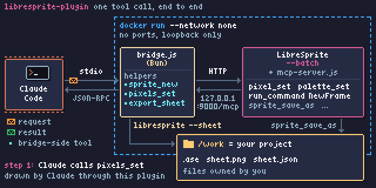

# libresprite-mcp



<sub>Drawn by Claude through this plugin's own MCP tools (`sprite_new`, `palette_set`, `pixels_set`,
`run_command`, `frame_duration`, `export_sheet`); the driver is
[`docs/diagram/draw.js`](docs/diagram/draw.js).</sub>

A Claude Code plugin that lets Claude draw, animate and export pixel art with
[LibreSprite](https://github.com/LibreSprite/LibreSprite), the GPL-2.0 fork of Aseprite,
through LibreSprite's own built-in MCP server.

LibreSprite runs headless in a Docker container. A small Bun bridge (`bridge.js`, no
dependencies) inside the same container starts it, then relays MCP JSON-RPC between the
container's stdin/stdout and the server's Streamable HTTP endpoint on the container's
loopback. No port is published and the container runs with `--network none`.

## Install

You need **Docker**, running and usable by your user. Nothing else: the image is prebuilt for
amd64 and arm64 at `ghcr.io/amrevr/libresprite-mcp`.

```sh
claude plugin marketplace add amrevr/libresprite-mcp
claude plugin install libresprite-mcp@libresprite-mcp
```

Inside a session, `/plugin marketplace add amrevr/libresprite-mcp` and
`/plugin install libresprite-mcp@libresprite-mcp` do the same. Claude Code clones the
marketplace over SSH when you have a GitHub SSH key; without one, set
`CLAUDE_CODE_PLUGIN_PREFER_HTTPS=1` first.

The first tool call pulls the image, so it takes longer. The server sees only the project you
run Claude Code in, mounted at `/work`.

**First use.** In a project, ask for example:

> Make a 16x16 pixel-art coin with a 4-frame spin animation and export a sprite sheet to art/coin.

Claude follows the bundled `libresprite-pixel-art` skill and writes `art/coin.ase`,
`art/coin.png` (the sheet) and `art/coin.json`.

**Update.** `claude plugin marketplace update libresprite-mcp`, then
`claude plugin update libresprite-mcp@libresprite-mcp`. Each plugin version pins the image tag
of the same version, which Docker pulls on first use.

**Uninstall.** `claude plugin uninstall libresprite-mcp@libresprite-mcp`, then
`claude plugin marketplace remove libresprite-mcp`, and to free the disk space
`docker image rm ghcr.io/amrevr/libresprite-mcp:0.1.0`.

### Advanced: build the image yourself

```sh
git clone git@github.com:amrevr/libresprite-mcp.git   # or https://github.com/amrevr/libresprite-mcp.git
cd libresprite-mcp
docker build -t libresprite-mcp .
./test/run.sh libresprite-mcp                         # the test suite, inside the image
export LIBRESPRITE_MCP_IMAGE=libresprite-mcp          # then start claude: the plugin runs this image
```

`.mcp.json` runs `${LIBRESPRITE_MCP_IMAGE:-ghcr.io/amrevr/libresprite-mcp:0.1.0}`. To try a
checkout without installing it, run `claude --plugin-dir ./libresprite-mcp`.

The build compiles LibreSprite at commit `2be695f986ee210cb6bd0c210093b6f08686717f`
(`--build-arg LIBRESPRITE_COMMIT=<full sha>` picks another) on Debian trixie, with CMake 4.4.3
from Kitware's release tarball. The runtime stage is `debian:trixie-slim` with the binary, its
`data/` directory, its shared libraries and Bun 1.4.3. CI (`.github/workflows/image.yml`)
builds it natively on amd64 and arm64 and runs the tests inside each image.

## Tools

The 11 tools of LibreSprite's server, passed through unchanged: `sprite_info`,
`sprite_image`, `pixel_get`, `pixel_set`, `palette_get`, `palette_set`, `layers_list`,
`sprite_save`, `sprite_save_as`, `command_info`, `run_command`.

Four tools added by the bridge:

- `sprite_new {w, h, colorMode?}`: a blank transparent sprite (rgb, grayscale or indexed,
  1-4096 px a side). Headless LibreSprite can't run `NewFile` (it needs a dialog), so the
  bridge writes a seed PNG and restarts LibreSprite on it. The previous document is closed
  without saving.
- `pixels_set`: up to 10000 pixels in one call, as `pixels: [{x, y, color}]` or as
  `rows` of characters with a character-to-color `palette` (plus `x`, `y`, `frame`, `layer`).
  Every coordinate and color is checked before the first pixel is drawn.
- `frame_duration {ms, frame?}`: frame timing (`FrameProperties` needs a dialog). The bridge
  rewrites the durations in a saved `.ase` and reopens it.
- `export_sheet {path?, inline?}`: saves the sprite as `.ase` (default `/work/sprite.ase`),
  then runs `libresprite --batch <ase> --sheet <name>.png --data <name>.json` and returns the
  three paths, plus the sheet as image content when `inline` is true. (`ExportSpriteSheet`
  over MCP writes nothing, because it takes the output path from prefs.)

The skill `skills/libresprite-pixel-art` teaches Claude the workflow: palette discipline,
silhouette then shading, frame conventions, critique passes with `sprite_image`, and export.

## Test

`./test/run.sh [image]` runs `bun test` inside the image. `test/bridge.test.js` drives the
bridge over stdio: `tools/list` (15 tools), `sprite_new`, `pixel_set`/`pixel_get`,
`pixels_set` (rows and lists, last write wins, all-or-nothing validation), `NewFrame`,
`frame_duration` and `export_sheet` (decodes the sheet and checks each frame and duration). It
also checks a clean exit on stdin EOF, that a dialog-opening command times out instead of
hanging, and that files written into `/work` belong to `/work`'s owner.

## Security

- LibreSprite's MCP server has no authentication. It listens on `127.0.0.1` inside the
  container only; nothing is published to the host, and `--network none` leaves the
  container with loopback only, so nothing outside the container can reach it.
- The container can read and write the whole mounted project directory (`/work`): any path
  Claude passes to `sprite_save_as` or `export_sheet` is written there. It sees no other
  host files.
- The container runs as root. So that its files are not root-owned on Linux hosts, the bridge
  chowns what it and LibreSprite write under `/work` to the owner of `/work`.

## Limits

- One document at a time. `sprite_new` replaces it; open an existing file with
  `run_command OpenFile {"filename": "/work/x.ase"}` (not covered by the tests).
- Headless LibreSprite cannot show dialogs. A command that opens one (`NewFile`,
  `NewFrameTag`, most `*Properties`) blocks it; after 30 s
  (`LIBRESPRITE_TIMEOUT_MS`) the bridge stops LibreSprite and unsaved changes are lost.
- `NewLayer` makes a layer with no cels, so `pixel_set` on it fails; frame tags can't be made.
- LibreSprite's server answers about one request per 10 ms tick, so `pixels_set` keeps 8
  requests in flight: about 6 ms a pixel. The diagram above took a few minutes to draw.
- Sheets are one row, with the CLI's default options.

## Licence and source

This repository's own code (bridge, tests, Dockerfile, workflows, plugin files, skill) is under
the MIT licence; see `LICENSE`.

LibreSprite is GPL-2.0-only. The published image contains the LibreSprite binary built from
the commit pinned in the `Dockerfile` (also recorded in the image label
`io.github.amrevr.libresprite-mcp.libresprite-commit`). **The complete corresponding source**
of that commit, submodules included, is attached to every
[release](https://github.com/amrevr/libresprite-mcp/releases) as
`libresprite-<commit>-source.tar.gz`. The bridge runs LibreSprite as a separate process and
talks to it over HTTP and the command line, without linking it.

Maintainers cut a release by tagging the merged commit with the version in
`.claude-plugin/plugin.json`: `git tag v0.1.0 && git push git@github.com:amrevr/libresprite-mcp.git v0.1.0`.
CI then publishes the `0.1.0` and `0.1` image tags and the release workflow attaches the source.

## Credits

- [LibreSprite](https://github.com/LibreSprite/LibreSprite) (GPL-2.0) and its built-in MCP
  server, `data/scripts/mcp-server.js`.
- The skill's pixel-art concepts (palette discipline, frame and tag conventions, small-sprite
  workflow, critique passes, export steps) come from
  [willibrandon/pixel-plugin](https://github.com/willibrandon/pixel-plugin) (MIT). No code is
  copied; the skill is rewritten for this tool set.
